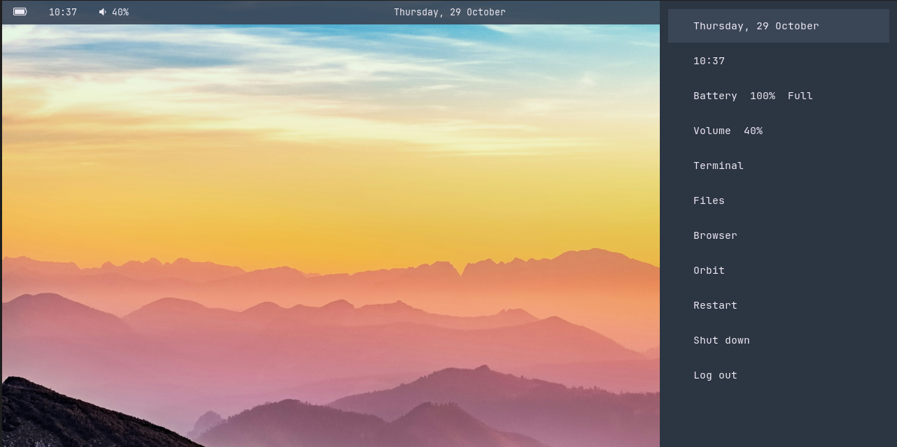
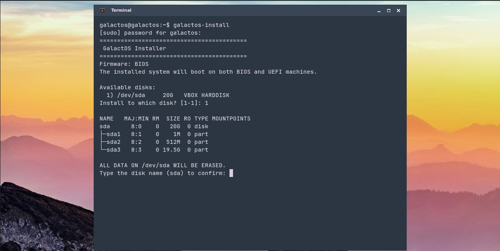

[](https://github.com/Deepsayan-Das/GalactOS/actions/workflows/ci.yml)

# GalactOS

A developer-first, Debian-based Linux distribution built from scratch via a documented, reproducible pipeline — not a repack of an existing distribution.

GalactOS boots into a custom, lightweight Openbox desktop environment powered by modern developer utilities, including [`nova`](https://github.com/Deepsayan-Das/nova) (container, Kubernetes, and project management CLI) and `orbit` (local AI coding assistant), installed through a real, GPG-signed APT repository rather than bundled ad-hoc binaries.

---

## Screenshots

<!-- Screenshot placeholders: images located in docs/img/ -->

*GalactOS Openbox desktop session with Polybar, Tint2, and Alacritty*


*Web-Greeter HTML/JS login screen with GalactOS branding*


*Whole-disk CLI installer running in terminal*

---

## Features

- **Debian Stable Minbase Foundation**: Bootstrapped directly from official Debian repositories (`deb.debian.org`) using `debootstrap --variant=minbase`, maintaining full compatibility with Debian package archives.
- **Custom OS Identity**: Branded system identity (`GalactOS 1.0 (Ignition)` / `GalactOS GNU/Linux`) configured in `/etc/os-release` and `/etc/issue`.
- **Integrated Developer Tooling**:
  - [`nova`](https://github.com/Deepsayan-Das/nova): Project scaffolding, system diagnostics, and container engine management.
  - `orbit`: AI coding assistant with CLI launcher (`/usr/bin/orbit`, `/usr/local/bin/orbit-launch`).
  - Dedicated APT repository (`https://deepsayan-das.github.io/nova`) with GPG verification keyring (`/etc/apt/keyrings/galactos.gpg`).
- **Baseline Developer Packages**: `git`, `curl`, `wget`, `vim`, `make`, `build-essential`, `sudo`, `ssh`, `ca-certificates`, `fdisk`, `e2fsprogs`, and `rsync`.
- **Modern CLI Stack** (`packages-extra.txt`): `fish`, `tmux`, `fzf`, `ripgrep`, `fd` (`fd-find`), `bat` (`batcat`), `jq`, `htop`, `btop`, `tree`, `bash-completion`.
- **Pre-installed Runtimes & Toolchains**: `python3-pip`, `python3-venv`, `pipx`, `cmake`, `gdb`, `shellcheck`, `sqlite3`, `gh`, `git-lfs`, `nodejs`, `npm`, `golang-go`, `podman`, `podman-compose`.
- **Lightweight Openbox Desktop**:
  - Openbox window manager configured with the `GalactOS-Dark` theme and custom monochrome XBM control buttons.
  - LightDM display manager paired with Web-Greeter 4.0.0 running a custom HTML/CSS/JavaScript theme.
  - Picom compositor for transparency, smooth shadows, and tear-free rendering.
  - Dual bar setup: Polybar top status bar and Tint2 bottom taskbar dock.
  - Rofi launcher (`Super+Space`) and sidebar panel (date, battery, volume, app shortcuts, power menu) (`rofi/sidebar.sh`).
  - GPU-accelerated Alacritty terminal emulator configured with JetBrains Mono font.
  - Productivity suite: Firefox ESR, PCManFM, Gedit, LibreOffice (Writer, Calc, Impress), Atril, Ristretto, Xarchiver, Galculator, MPV, Dunst, and LXPolKit.
- **Hybrid BIOS & UEFI Support**: The live ISO and the installed target system boot interchangeably on both legacy BIOS and 64-bit UEFI firmware.

---

## Installation Guide

GalactOS provides an interactive CLI installer bundled directly into the live ISO.

### System Requirements
- **CPU**: 64-bit x86-64 processor.
- **Memory**: Minimum 2048 MB (2 GB) RAM.
- **Storage**: Minimum 12 GB storage drive (the installer validates `blockdev --getsize64 >= 12000000000` bytes).
- **Firmware**: Legacy BIOS or UEFI (**Secure Boot must be disabled in firmware**).

### 1. Write the USB Medium
Write the downloaded ISO file (`galactos-gui-v*.iso`) to a USB flash drive using either:
- **Rufus (Windows)**: When prompted, you **must select DD Image mode** (ISO Image mode may not preserve hybrid GRUB partition structures).
- **balenaEtcher (Windows/macOS/Linux)**: Flash the ISO directly to the target USB drive.

### 2. Configure Host Firmware
- **Disable Secure Boot**: The GalactOS ISO uses an unsigned GRUB bootloader without Microsoft UEFI Secure Boot signing keys. You must disable Secure Boot in your motherboard's UEFI/BIOS settings.
- Select the USB drive from your system boot menu.

### 3. Boot the Live Environment
1. At the GRUB menu, select **GalactOS Live** (or the debug entry if diagnosing boot issues).
2. The Web-Greeter login screen will appear. Log in using the default live credentials:
   - **Username**: `galactos`
   - **Password**: `galactos`

### 4. Launch the Installer
1. Open a terminal (press `Ctrl + Alt + T` or launch Alacritty from the menu).
2. Start the installer script with root privileges:
   ```bash
   sudo galactos-install
   ```
3. **Follow the interactive prompts**:
   - **Target Disk Selection**: Choose the destination disk number from the list. (The installer automatically excludes the live USB source drive).
   - **Confirmation**: Type the exact disk device name (e.g. `sda` or `nvme0n1`) to confirm. **All existing partitions and data on this disk will be permanently erased.**
   - **Computer Name**: Enter a hostname (default: `galactos`).
   - **User Account**: Enter your desired username (cannot be `root`) and set a password.
4. The installer will partition the disk (GPT), format the filesystems (FAT32 EFI and ext4 root), copy the system with `rsync`, generate machine UUIDs and `/etc/fstab`, create your user account, lock the root password, and install GRUB for both BIOS and UEFI.

### 5. First Boot
1. Once the installer prints `"Install complete."`, choose `y` to reboot (or power off manually).
2. **Remove the USB drive** (or detach the ISO from your virtual machine's optical drive).
3. Power on the system: GalactOS will boot directly from your hard disk. Log in with the username and password created during installation.

---

## Download

> [!IMPORTANT]
> The ISO upload to the GitHub Release page is currently **in progress**. Once complete, three 7-Zip split parts will be attached to the [**GalactOS 1.0.0 Release**](https://github.com/Deepsayan-Das/GalactOS/releases/tag/v1.0.0), together with `SHA256SUMS.txt` for integrity verification. Until then, please [build from source](#building-from-source).

### Files

| File | Size (approx.) |
|------|----------------|
| `galactos-1.0.0-amd64.iso.7z.001` | ~1 GB |
| `galactos-1.0.0-amd64.iso.7z.002` | ~1 GB |
| `galactos-1.0.0-amd64.iso.7z.003` | ~1 GB |
| `SHA256SUMS.txt` | — |

### Step 1 — Download

Download all three `.7z.00*` parts **and** `SHA256SUMS.txt` from the [Releases page](https://github.com/Deepsayan-Das/GalactOS/releases/tag/v1.0.0) into the **same folder**.

### Step 2 — Verify the Parts

**Windows (PowerShell):**
```powershell
Get-FileHash galactos-1.0.0-amd64.iso.7z.001 -Algorithm SHA256
Get-FileHash galactos-1.0.0-amd64.iso.7z.002 -Algorithm SHA256
Get-FileHash galactos-1.0.0-amd64.iso.7z.003 -Algorithm SHA256
```
Compare each hash against the corresponding entry in `SHA256SUMS.txt`.

**Linux:**
```bash
sha256sum -c SHA256SUMS.txt
```

### Step 3 — Extract the ISO

**Windows** — open `galactos-1.0.0-amd64.iso.7z.001` with [7-Zip](https://www.7-zip.org/); it will automatically locate the remaining parts and extract the ISO.

**Linux** — install `p7zip-full` and run:
```bash
7z x galactos-1.0.0-amd64.iso.7z.001
```
7-Zip will join and extract all parts automatically.

### Step 4 — Verify the Extracted ISO

After extraction, verify the resulting `.iso` file:

**Windows (PowerShell):**
```powershell
Get-FileHash galactos-1.0.0-amd64.iso -Algorithm SHA256
```

**Linux:**
```bash
sha256sum galactos-1.0.0-amd64.iso
```

Expected SHA-256:
```
942af2aac67a379ad363fd684c4a668739b503a1bc9c21f61b90129731fd87eb
```

Proceed to the [Installation Guide](#installation-guide) once the ISO is verified.

---

## Building from Source

To build a fresh release ISO from source:

### Prerequisites
On a Debian or Ubuntu 64-bit host system:
```bash
sudo apt update
sudo apt install -y debootstrap xorriso squashfs-tools \
    grub-pc-bin grub-efi-amd64-bin mtools dosfstools curl wget rsync git
```

### Build with `make_iso.sh`
The primary build orchestrator is `iso/make_iso.sh`:

```bash
cd iso

# Build an ISO with a specified version number (e.g. version 26)
./make_iso.sh 26
```

This will:
1. Perform pre-flight safety checks (free space, mount validation, UEFI tooling).
2. Refresh the GUI layer (`build-gui.sh`) and system configuration layer (`build-system.sh`).
3. Bundle `installer/galactos-install` into `/usr/local/bin/galactos-install`.
4. Validate rootfs integrity.
5. Compress the rootfs into SquashFS and package `galactos-gui-v26.iso` using `grub-mkrescue`.
6. Copy the output ISO to the destination path (defaults to `/mnt/d/vbox-gui-iso`, or overridden via the `ISO_DEST` environment variable) and verify SHA256 checksums.

For full build flags, individual layer documentation, and standalone QEMU disk image building (`build.sh`), refer to [`docs/BUILD.md`](docs/BUILD.md).

---

## Repository Layout

```
.
├── .github/
│   └── workflows/
│       └── ci.yml             # GitHub Actions CI workflow (scripts, hygiene, packaging)
├── .gitattributes             # Forces LF line endings on *.sh and installer
├── .gitignore
├── CHANGELOG.md               # Version history and release notes
├── README.md                  # Project overview and quickstart
├── build.sh                   # Standalone legacy builder: directly creates galactos.img (QEMU)
├── docs/
│   ├── BUILD.md               # Comprehensive build documentation
│   ├── INSTALLER.md           # Technical installer and partitioning reference
│   ├── LEARNING-GUI.md        # Plain-language explanation of the Openbox desktop stack
│   ├── LEARNING-INSTALLER.md  # Plain-language explanation of live-to-disk installation
│   └── img/                   # Documentation screenshots
└── iso/
    ├── build-gui.sh           # Installs Openbox, Web-Greeter, Polybar, Alacritty, themes
    ├── build-iso.sh           # Packages rootfs into bootable hybrid live ISO (mksquashfs, GRUB)
    ├── build-rootfs.sh        # Bootstraps Debian base rootfs, Nova & Orbit repos, kernel
    ├── build-system.sh        # Installs packages-extra.txt, locales, /etc/skel, live user
    ├── make_iso.sh            # Automated ISO build orchestrator with verification
    ├── grub/
    │   └── grub.cfg           # Live ISO GRUB boot menu configuration
    ├── gui/
    │   ├── assets/            # Configs (openbox, polybar, tint2, picom, rofi, keybinds, icons)
    │   ├── greeter-theme/     # Web-Greeter custom HTML/CSS/JavaScript theme
    │   └── packages-extra.txt # List of CLI and GUI desktop packages
    ├── installer/
    │   └── galactos-install   # Live system-to-disk interactive installer script
    └── packaging/
        └── orbit/
            ├── build-orbit-deb.sh # Debian packaging script for Orbit
            ├── control            # Debian package control metadata
            ├── orbit              # Orbit CLI runner wrapper
            └── orbit-configure    # Orbit initial setup wrapper
```

---

## Known Issues

- **No Sound in Virtual Machines**: Audio daemons (`pipewire`, `wireplumber`, `alsa-utils`) are pre-installed, but virtual sound devices in VirtualBox or QEMU may not automatically map to the host audio output without manual configuration.
- **Unsigned ISO**: The live ISO does not include Microsoft Secure Boot signatures. UEFI Secure Boot must be disabled in system firmware to boot the ISO.
- **Whole-Disk Installation Only**: The installer executes `wipefs -af` and `sgdisk --zap-all` on the target drive. It does not support manual partitioning, resizing existing partitions, or dual-booting with other operating systems.
- **No Swap Space Configured**: The installer provisions only EFI and ext4 root partitions. It does not create a swap partition or a swapfile. Swapfiles can be configured manually post-installation if required.
- **UTC Timezone Default**: The installer does not feature an interactive timezone selection prompt; the system clock defaults to UTC. Timezone can be adjusted after installation using `timedatectl`.
- **No Disk Encryption**: The installer formats the root partition as plain ext4 without LUKS full-disk encryption support.

---

## Architecture Notes: `build.sh` vs `iso/build-rootfs.sh`

> [!NOTE]
> `build.sh` and `iso/build-rootfs.sh` are **independent scripts**:
> - `build.sh` is an autonomous script that bootstraps a minimal Debian system directly into a raw 2 GB disk image (`galactos.img`) partitioned with MBR for fast local QEMU testing.
> - `iso/build-rootfs.sh` is part of the modular ISO pipeline in `iso/`. It builds the full, branded rootfs (`live-rootfs`) containing the desktop GUI, extended developer packages, live-boot support, and installer scripts.
>
> `build.sh` does **not** call or share `iso/build-rootfs.sh`.

---

## Third-Party Credits & Acknowledgments

GalactOS builds upon exceptional open-source software:
- [Debian GNU/Linux](https://www.debian.org/): Upstream base distribution and package repositories.
- [Openbox](http://openbox.org/): Ultra-lightweight, customizable X11 window manager.
- [Web-Greeter](https://github.com/JezerM/web-greeter) by JezerM: HTML/CSS/JS greeter for LightDM.
- [LightDM](https://github.com/canonical/lightdm): Cross-desktop display manager.
- [Picom](https://github.com/yshui/picom): Lightweight X11 compositor.
- [Polybar](https://github.com/polybar/polybar): Fast, customizable status bar.
- [Tint2](https://gitlab.com/o9000/tint2): Lightweight panel and taskbar.
- [Rofi](https://github.com/davatorium/rofi): Window switcher, application launcher, and dmenu replacement.
- [Alacritty](https://github.com/alacritty/alacritty): Fast, GPU-accelerated terminal emulator.
- [Arc Theme](https://github.com/horst3180/arc-theme) & [Papirus Icon Theme](https://github.com/PapirusDevelopmentTeam/papirus-icon-theme): Visual styling.
- [JetBrains Mono](https://www.jetbrains.com/lp/mono/), [Inter](https://rsms.me/inter/), and [Font Awesome](https://fontawesome.com/): Desktop typography and iconography.
- [`nova`](https://github.com/Deepsayan-Das/nova) & Orbit: Developer CLI tools by Deepsayan Das.

---

## License

GalactOS is open-source software licensed under the [MIT License](LICENSE). Copyright &copy; 2026 Deepsayan Das.

The live and installed system images bundle third-party software and upstream Debian packages under their own respective open-source licenses (such as GPL, LGPL, BSD, Apache, and MIT). Pre-installed third-party software retains its original copyright and license terms.